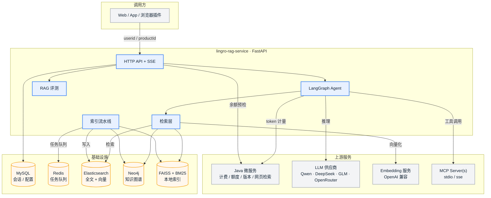
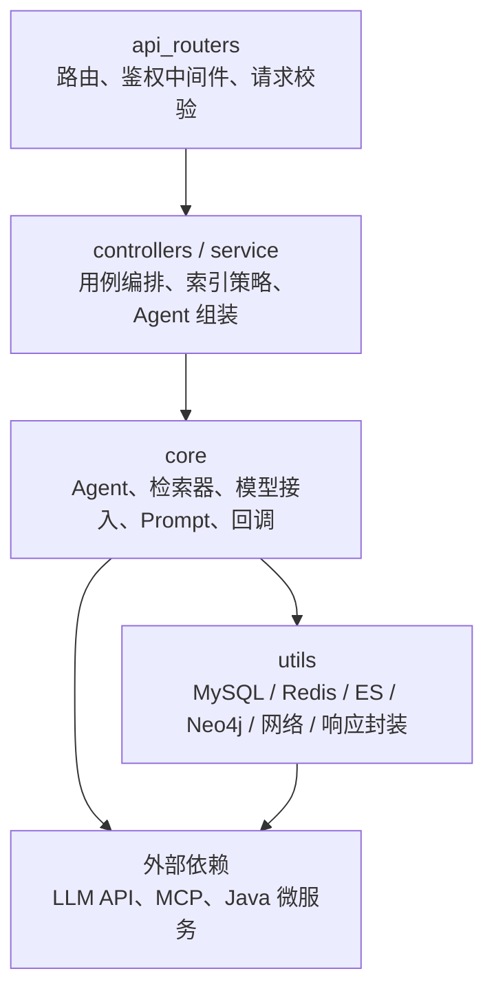

# Lingro RAG Service

面向语言学习场景的多策略 RAG 问答服务：接收自然语言问题，在本地知识库（向量 / 倒排 / 知识图谱 / 网络）中检索，由 LangGraph Agent 编排工具调用，并以 SSE 流式返回带出处的答案。


> **状态说明**
> 这套服务曾作为 Lingro 的后端上线运营，目前已下线。本仓库是生产代码的**脱敏公开快照**：
> 不含密钥、内部地址、企业文档与用户数据；少量与运行相关的 bug 已修复，其余问题如实列在
> [已知限制](#已知限制) 中。完整实现与演示可在面试中现场讲解。

---

## 目录

- [为什么做这个](#为什么做这个)
- [能力概览](#能力概览)
- [架构](#架构)
- [核心流程](#核心流程)
- [关键设计](#关键设计)
- [快速开始](#快速开始)
- [API](#api)
- [目录结构](#目录结构)
- [评测](#评测)
- [已知限制](#已知限制)
- [与生产版本的差异](#与生产版本的差异)
- [致谢](#致谢)

---

## 为什么做这个

2024 年，一家企业的下游运营商经常就产品与流程文档反复询问总部。文档散落在文件服务器和网盘里、更新频繁、还有大量扫描件，人工答疑成本很高。最初的目标很简单：做一个**能带出处回答**的知识库问答。

上线后陆续暴露的问题推动了功能演进：

| 真实问题 | 对应能力 |
|---|---|
| 文档放在 FTP / SFTP / 网盘，靠人工同步 | 多数据源定时同步 + SHA-256 增量识别 |
| 文档经常更新，新旧版本混用 | 知识库多版本索引，构建成功才切换 |
| 大量扫描件与 PDF | MinerU OCR / unstructured 多格式解析 |
| 培训视频、会议录音 | 语音转写后入库 |
| 答案必须可信 | 带相似度分数的引用、混合检索、知识图谱检索 |
| 答案质量无法衡量 | RAGChecker 自动评测 |
| 需要开放给更多人使用 | 多模型适配、计费、MCP 工具、多端接入 |

这套能力后来被扩展成面向公众的平台，本仓库即其中的 AI 服务层。

---

## 能力概览

| 能力 | 实现要点 | 代码入口 |
|---|---|---|
| **Agent 编排与演进** | 从手写 ReAct 循环迁移到 LangChain 1.x `create_agent`；Agent State 与 Runtime Context 分离 | `service/chat_agent_service.py`、`controllers/vo/startup_llm_model_request_vo.py` |
| **多策略检索** | 7 种检索类型 → 4 种后端（FAISS+BM25 / Elasticsearch / Neo4j 图谱 / 网络），支持混合与加权融合 | `core/data_connections/retrievers/` |
| **知识图谱 RAG** | HippoRAG：OpenIE 抽取 → 实体消歧 → 图构建 → Personalized PageRank 检索 | `core/.../hipproRAG/` |
| **MCP 全链路** | 配置发现 → 连接 → 工具转换为 LangChain Tool → 注入 Agent | `tools_definitions/mcp/`、`api_routers/mcp.py` |
| **上下文与成本控制** | 工具返回拆成 `content` / `artifact`，引用元数据不进模型上下文；按模型上下文上限截断检索结果 | `tools_definitions/tools/retriever_tools.py` |
| **分层模型路由** | 单一工厂按模型名分派到 8 类供应商实现，46 个模型产品共享统一配置 | `core/model_io/llm_models/default_langchain_llm.py` |
| **流式协议** | SSE 输出文本增量、tool_call 参数拼接、工具结果、引用元数据与 `[DONE]` | `service/chat_message_util.py` |
| **计费闭环** | 请求前余额预检（402 中断）+ 推理后按 token 计量上报，含缓存命中拆分 | `api_routers/llm.py`、`core/callbacks/llm_callbacks.py` |
| **索引流水线** | 加载 → 切分 → 向量化 → 写 ES / FAISS / Neo4j → 保存 docstore，支持定时任务与重试 | `controllers/dispatch_handlers/`、`controllers/schedulers/` |
| **RAG 评测** | RAGChecker 12 项指标 + 4 维 LLM-as-Judge 加权评分 | `rag_checker/` |

规模数字（均可在代码中核对）：**46** 个模型产品、**3** 个 embedding 模型、**7** 种检索类型、**4** 种检索后端、**9** 个内置工具、**12** 项评测指标。

---

## 架构

### 系统上下文



> 图片版：[docs/diagrams/system-context.png](docs/diagrams/system-context.png)

### 分层与依赖方向



更完整的图（含对话时序、索引构建、检索路由、计费链路）见 **[docs/architecture.md](docs/architecture.md)**。

---

## 核心流程

### 一次对话请求

```
POST /llm-backend/v1/chat-stream/completions
  │
  ├─ UserContextMiddleware            把 userid 写入 context，供工具读取
  ├─ pre_request_check                调 Java 微服务做余额预检，不足直接 402
  ├─ SupportedModelsInfoUtil          按 model_id 取模型配置与上下文上限
  ├─ DefaultLangchainLLM              工厂选择供应商实现，挂上计费回调
  ├─ DefaultChatAgentService._setup_default_agent()
  │    ├─ 组装工具：检索 / 文件读取 / 总结 / 日期 / MCP
  │    ├─ 组装 ReAct system prompt（按语言、是否有知识库、是否有插件）
  │    ├─ context = ApplicationContext(user_id, llm_client)
  │    └─ create_agent(model, state_schema, context_schema, tools)
  │
  ├─ agent.astream(..., stream_mode="messages")
  │    ├─ LLM 推理 → 供应商 API
  │    ├─ Tool: search_relevant_documents → DefaultRetrieverV2
  │    ├─ Tool: MCP 工具 → MCP Server
  │    └─ Callback: on_llm_end → 上报 token 用量
  │
  └─ StreamingResponse(text/event-stream)
       content / tool_call / tool_message / addition_info(引用) / [DONE]
```

### 一次索引构建

```
POST /knowledge-index/v1/build
  ├─ BuildKnowledgeIndexTypeEnum 选择策略（向量 / ES / 图谱）
  ├─ 文件加载（unstructured + OCR）
  ├─ 文本切分（中英文分别配置 chunk / overlap，父子块）
  ├─ 向量化（embedding 服务，分批 + 重试）
  ├─ 写入目标后端：FAISS + BM25 / Elasticsearch / Neo4j
  └─ 保存 docstore，回调 Java 服务通知版本可用
```

---

## 关键设计

### 1. 为什么工具返回要拆成 content 与 artifact

检索工具使用 LangChain 的 `response_format="content_and_artifact"`（`retriever_tools.py:43`）：

- `content`：只放会进入模型上下文的文档正文；
- `artifact`：文档 id、相似度、来源文件名等元数据，只用于前端展示引用。

这样引用信息不会重复占用上下文，也不会诱导模型"复述元数据"。非流式接口再从 `ToolMessage.artifact` 里取出引用，与答案一起返回。

### 2. 上下文预算按模型能力计算

模型配置里带 `context_tokens_limit`（46 个产品各不相同，从 64K 到 1M+）。检索工具在拼装文档时累计 token，超过上限即停止追加并记录日志（`retriever_tools.py:328-371`），而不是把结果截断成半句话。默认上限 `DEFAULT_CONTEXT_TOKENS_LIMIT=6000` 只用于兜底。

### 3. Map-Reduce 摘要使用两档模型

长文档摘要拆成 map / reduce 两阶段，并刻意使用不同档位的模型（`configs/model_config.py`）：

| 阶段 | 模型 | 输出上限 | 理由 |
|---|---|---|---|
| map（逐段摘要） | `MODEL-0008` qwen-flash | 1800 tokens | 量大、任务简单，用便宜快的模型 |
| reduce（合并摘要） | `MODEL-0004` qwen-max | 4800 tokens | 只调用一次，质量优先 |

### 4. 单一模型工厂，多种供应商实现

`DefaultLangchainLLM.get_llm_client()` 按模型名分派到 Qwen / GLM / Gemini / OpenAI 兼容 / DeepSeek / OpenRouter(Claude、Gemini、Grok) 等实现，每个实现自带流式解析与 usage 统计。新增供应商只需实现一个 `BaseChatModel` 子类并在工厂注册，业务层无需感知。

### 5. 计费的两段式设计

- **前置**：`pre_request_check` 在推理前查余额，不足返回 402，避免"答完才发现没钱"；
- **后置**：`on_llm_end` 回调读取 `usage_metadata`，区分 `input_tokens` / `output_tokens` / 缓存写入与读取，异步上报；上报失败只记日志，不阻断对话。

### 6. 混合检索的融合方式

`MIXED_*` 类型会同时调用两路检索器，按 `fixed_weights`（和为 1）加权后合并，再做去重与可选重排；`use_embedding_filter_assist` 可挂相似度过滤器，`use_reorder_assist` 可启用 LongContextReorder 缓解"中间信息丢失"。

详见 **[docs/design-notes.md](docs/design-notes.md)**。

---

## 快速开始

### 依赖

- Python **3.12**（`>=3.12,<3.13`）
- [uv](https://docs.astral.sh/uv/)（推荐）或 pip
- 外部服务：MySQL、Redis、Elasticsearch、Neo4j（按需），以及一个 OpenAI 兼容的 embedding 服务
- 系统库（文档解析）：`libmagic`、`poppler`、`libreoffice`、`pandoc`、`tesseract-ocr`（含中文包）
- GPU：`faiss-gpu-cu12` 需要 CUDA 12；无 GPU 请把 `pyproject.toml` 中的 `faiss-gpu-cu12` 换成 `faiss-cpu`

### 安装与配置

```bash
git clone https://github.com/crixue/lingro-rag-service.git
cd lingro-rag-service

cp .env.example .env        # 填入模型 Key 与中间件地址
uv sync                     # 或 pip install -r pyproject.toml
```

`APP_ENV=local` 时缺少环境变量只告警；设为 `dev` / `prod`（或 `STRICT_ENV_VALIDATION=true`）时缺少必需变量会直接退出。

### 启动

```bash
uv run uvicorn app:app --host 0.0.0.0 --port 8000
```

- 健康检查：`GET /health/liveness`、`GET /health/readiness`
- 交互式文档：`http://localhost:8000/docs`

> 没有 Redis 时索引任务调度器会自动降级为空转（`ENABLE_INDEX_SCHEDULER=false` 可显式关闭），不影响对话接口启动。

### 调用示例

鉴权与计费在网关 / Java 微服务侧完成，本服务只读取 `userid`、`productId` 请求头：

```bash
curl -N -X POST http://localhost:8000/llm-backend/v1/chat-stream/completions \
  -H "Content-Type: application/json" \
  -H "userid: demo-user" \
  -H "productId: MODEL-0002" \
  -d '{
    "query": "知识库支持哪些文件格式？",
    "history_messages": [
      {"role": "system", "content": "你是 Lingro 的知识库助手，请基于检索结果回答，并给出出处。"}
    ],
    "used_model_config": {"is_chinese_text": true, "have_context": true, "llm_id": "MODEL-0002"},
    "retriever_config": {
      "retriever_type": "A01",
      "knowledge_index_folder_id": "demo-folder",
      "knowledge_index_folder_name": "demo",
      "version": 1,
      "search_top_k": 5
    }
  }'
```

返回为 SSE，事件体与 OpenAI `chat.completion.chunk` 兼容，额外字段包括 `tool_call`、`tool_message`、`retriever_docs`。字段说明见 **[docs/api.md](docs/api.md)**。

---

## API

| 方法 | 路径 | 说明 |
|---|---|---|
| POST | `/llm-backend/v1/chat-stream/completions` | 流式对话（主接口） |
| POST | `/llm-backend/v1/chat/completions` | 非流式对话 |
| POST | `/llm-backend/v1/mock-chat-stream/completions` | 回放本地 mock SSE 数据，用于前端联调 |
| POST | `/knowledge-index/v1/build` | 构建索引 |
| DELETE | `/knowledge-index/v1/drop` | 删除指定索引 |
| DELETE | `/knowledge-index/v1/drop-version-of-kg-index` | 删除某版本的图谱索引 |
| DELETE | `/knowledge-index/v1/delete-workspace` | 删除整个工作区 |
| DELETE | `/knowledge-index/v1/chat-session/drop` | 删除会话产生的临时索引 |
| POST | `/mcp-servers/v1/tools/list` | 列出 MCP 工具 |
| POST | `/mcp-servers/v1/prompts/list` | 列出 MCP Prompt |
| POST | `/mcp-servers/v1/prompt/get` | 获取指定 MCP Prompt |
| POST | `/mcp-servers/v1/resources/list` | 列出 MCP Resource |
| POST | `/mcp-servers/v1/resources/templates/list` | 列出 MCP Resource 模板 |
| POST | `/rag-checker/v1/evaluate` | 触发 RAG 评测 |
| PUT | `/prompt/v1/serialize` | Prompt 序列化 |
| GET | `/plugins/v1/supported_functions` | 返回支持的内置函数列表 |

---

## 目录结构

```
.
├── app.py                        # FastAPI 入口：中间件、路由注册、健康检查、调度器生命周期
├── api_routers/                  # HTTP 层：对话、索引、MCP、评测、Prompt
├── controllers/
│   ├── dispatch_handlers/        # 三种索引构建策略（向量 / ES / 图谱）
│   ├── enums/                    # 索引类型、源类型、构建步骤等枚举
│   ├── schedulers/               # 基于 Redis 队列的索引任务消费
│   └── vo/                       # 请求 / 响应数据模型（Pydantic v2）
├── service/                      # Agent 编排与 SSE 消息格式化
├── core/
│   ├── agents/                   # 早期手写 ReAct Agent（保留用于对照演进）
│   ├── callbacks/                # token 计量回调
│   ├── data_connections/
│   │   ├── document_loaders/     # unstructured 加载与 OCR
│   │   ├── retrievers/           # 4 类检索后端 + 混合检索 + 图检索
│   │   └── text_spitters/        # 中英文切分策略
│   ├── embeddings/               # embedding 封装与批处理
│   └── model_io/                 # 模型工厂、各供应商实现、Prompt 模板
├── tools_definitions/            # 内置工具、工具 Schema、MCP 工具转换
├── rag_checker/                  # RAGChecker 指标实现与自定义评测器
├── prompt_definitions/           # 中英文 Prompt 模板（JSON）
├── json_schema_definitions/      # 结构化输出 Schema
├── context/                      # Agent State 与 Runtime Context
├── exceptions/                   # 业务异常与 FastAPI 异常处理器
├── utils/                        # MySQL / Redis / ES / Neo4j 客户端与通用工具
├── resources/mcp_deployment_configs/  # MCP Server 定义示例
├── test/                         # 集成脚本（需外部服务，说明见 test/README.md）
└── docs/                         # 架构、接口、设计取舍、评测、部署、脱敏说明
```

---

## 评测

`rag_checker/` 是对 [RAGChecker](https://github.com/amazon-science/RAGChecker) 的工程化改造：

- **检索指标**：claim recall、context precision
- **生成指标**：context utilization、noise sensitivity（相关 / 不相关）、hallucination、self knowledge、faithfulness
- **整体指标**：sentence precision、precision、recall、f1
- **自定义评测**：`CustomChecker` 用加权 LLM-as-Judge 给出 content accuracy / completeness / relevance / conciseness 四维评分与总分

支持通过 CLI 或 HTTP 触发，指标口径与样例见 **[docs/evaluation.md](docs/evaluation.md)**。

---

## 已知限制

公开版本保留了生产代码的真实形态，以下问题**未修复**，如实记录：

1. **索引类型分发不完整**：`BuildingIndexEntranceController._get_building_strategy` 只显式处理图谱与 ES，其余类型（含 3 个 `MIXED_*`）都落到向量库分支。
2. **MCP 缺少熔断**：工具注册失败时 Agent 可能反复重试；`prompts/resources` 接口未设置超时。
3. **队列可靠性**：索引任务用 `RPOP` 消费，进程异常退出时在途任务会丢失；生产上依赖人工重试接口补偿。
4. **测试资产是集成脚本**：`test/` 下 22 个脚本需要真实中间件，未纳入 CI，也没有单元测试基线。
5. **工具调用累积器是进程内字典**：按 `conversation_id` 隔离，长连接场景需要显式清理。
6. **鉴权依赖上游**：本服务只信任网关注入的 `userid` 请求头，不自行校验身份。
7. **非流式接口仅完成代码修复**：同步 / 异步混用问题已修，但未在完整环境重新回归。

更细的清单（含行号）见 **[docs/sanitization.md](docs/sanitization.md)** 与各模块注释。

---

## 与生产版本的差异

为保证可公开、可审阅，公开快照做了以下调整（不影响业务逻辑）：

| 类别 | 改动 |
|---|---|
| 密钥与地址 | 移除全部真实 Key、内网 IP、私有镜像仓库地址；改为 `.env` 注入 |
| 镜像构建 | `Dockerfile` / `base-nvidia-Dockerfile` 改为基于公共 CUDA 镜像自建，支持 `FAISS_SPEC` 切换 CPU 版 |
| 部署脚本 | `REGISTRY` / `APP_NAME` 参数化，去掉内部仓库硬编码 |
| 死代码 | 删除零引用的 vendored `langchain_google_genai`（约 2500 行）、空包、85 MB 离线 wheel |
| Bug 修复 | 非流式接口 async 修复；`rag_checker` 错误 logger；Redis 不可用时调度器降级；日志目录回退；CORS 可配置 |
| 测试数据 | 用合成文本替换了原先引用的第三方文章 |
| 数据 | 不含 `samples/`、`mock_data/`、`data/raw_data/` 等真实文档与缓存 |

完整清单见 **[docs/sanitization.md](docs/sanitization.md)**。

---

## 致谢

本项目站在这些开源工作之上：LangChain / LangGraph、[HippoRAG](https://github.com/OSU-NLP-Group/HippoRAG)、[RAGChecker](https://github.com/amazon-science/RAGChecker)、[RefChecker](https://github.com/amazon-science/RefChecker)、[unstructured](https://github.com/Unstructured-IO/unstructured)、[Wikipedia](https://github.com/goldsmith/Wikipedia)。归属与许可细节见 [NOTICE](NOTICE)。

---

## License

[MIT](LICENSE)

---

<details>
<summary><b>English TL;DR</b></summary>

**Lingro RAG Service** is a production-derived, multi-strategy RAG backend built with FastAPI, LangChain 1.2 and LangGraph.

- **Agent orchestration**: migrated from a hand-written ReAct loop to LangChain's `create_agent`, with separate agent state and runtime context, and tools injected per request (retrieval, file reading, summarization, MCP).
- **Retrieval**: 7 retriever types mapped onto 4 backends — FAISS + BM25, Elasticsearch, Neo4j knowledge graph (HippoRAG with Personalized PageRank), and web search — including weighted mixed retrieval.
- **Context engineering**: tool results are split into `content` (goes to the model) and `artifact` (UI-only citations); retrieved documents are accumulated against a per-model token budget instead of being truncated mid-sentence.
- **Cost control**: pre-flight balance check, per-model routing across 46 model products, and token accounting in an `on_llm_end` callback that separates prompt, completion and cached tokens.
- **Evaluation**: 12 RAGChecker metrics plus a weighted 4-criteria LLM-as-judge.

The service was operated publicly and is now discontinued. This repository is a **sanitized snapshot**: no credentials, internal endpoints, customer documents or user data. A short list of real defects is documented rather than hidden.

License: MIT.

</details>
