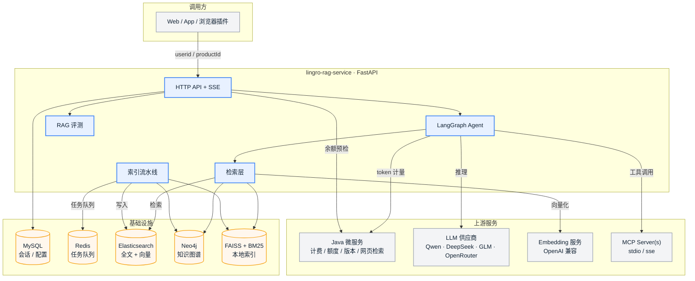
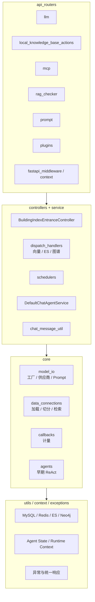
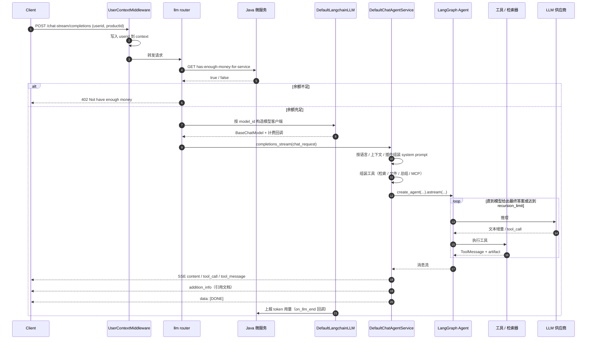
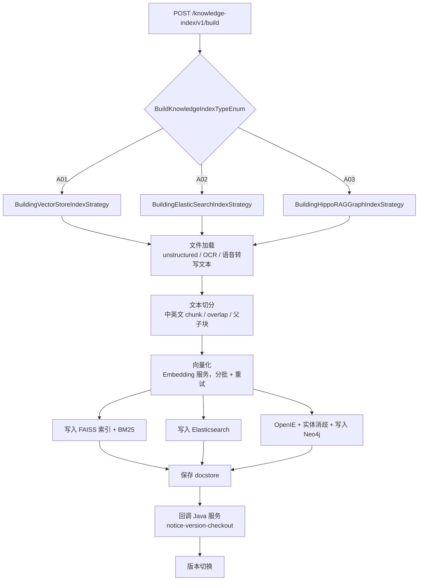
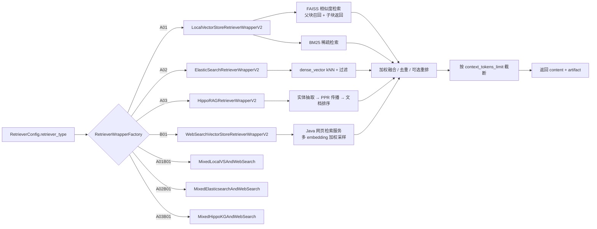
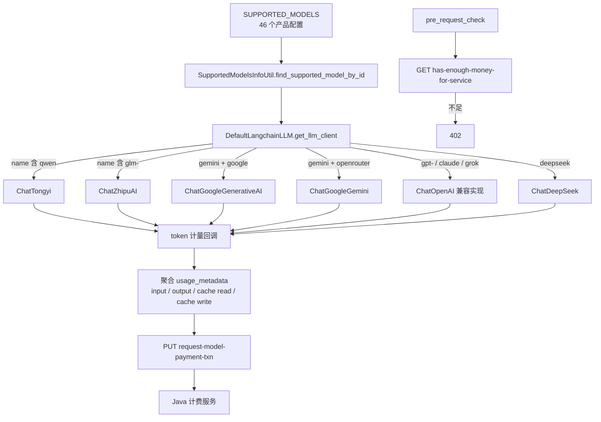

# 架构说明

本文描述服务的分层、组件职责与四条主要调用链。所有路径均可在仓库中定位。

## 1. 系统上下文

图片版：[diagrams/system-context.png](diagrams/system-context.png)

**边界**：本服务不负责用户注册、登录、权限与支付账本，只消费网关透传的 `userid` 与 `productId`，并把余额校验、令牌计量交给上游 Java 服务。

## 2. 分层结构

## 3. 对话调用链

图片版：[diagrams/chat-sequence.png](diagrams/chat-sequence.png)

关键实现：`api_routers/llm.py`、`api_routers/fastapi_middleware.py`、`service/chat_agent_service.py`、`core/callbacks/llm_callbacks.py`。

## 4. 索引构建

定时 / 异步入口：`controllers/schedulers/build_knowledge_index_schedule.py`（Redis 队列，两个消费者分别处理整包构建与单文件构建）。类型分发的已知缺口见 [sanitization.md](sanitization.md)。

## 5. 检索路由

实现：`core/data_connections/retrievers/default_retriever_wrapper_v2.py`（工厂）、`mixin_retreiver_wrapper_v2.py`（混合检索）、`knowlege_graph_retrievers/hipproRAG/`（图谱）。

## 6. 模型接入与计费

## 组件职责与位置

| 组件 | 职责 | 位置 |
|---|---|---|
| 路由层 | 参数校验、鉴权头提取、SSE 响应封装 | `api_routers/` |
| 中间件 | 把 `userid` 写入请求上下文，供工具与回调读取 | `api_routers/fastapi_middleware.py`、`api_routers/context.py` |
| Agent 服务 | 工具组装、Prompt 组装、流式/非流式调用、兜底语气 | `service/chat_agent_service.py` |
| SSE 格式化 | 文本增量、tool_call 参数拼接、工具消息、引用元数据 | `service/chat_message_util.py` |
| 索引入口 | 按类型选择构建策略，线程/事件循环兼容 | `controllers/making_index_entrance_controller.py` |
| 构建策略 | 加载 → 切分 → 向量化 → 写入后端 → 保存 docstore | `controllers/dispatch_handlers/` |
| 检索器 | 4 类后端 + 3 种混合组合 | `core/data_connections/retrievers/` |
| 模型工厂 | 按模型名分派供应商实现 | `core/model_io/llm_models/default_langchain_llm.py` |
| 工具 | 检索、文件读取、摘要、日期、知识库信息 | `tools_definitions/tools/` |
| MCP 桥接 | 配置加载、连接、工具转换 | `tools_definitions/mcp/`、`service_communication/` |
| 评测 | 12 项指标计算与 LLM Judge | `rag_checker/` |
| 状态定义 | Agent State 与 Runtime Context | `context/` |

## 数据存放

| 数据 | 位置 | 说明 |
|---|---|---|
| 会话 / 配置 | MySQL | 无 ORM，`PyMySQL` 直连 |
| 索引任务 | Redis List | 两个队列：整包构建、单文件构建 |
| 全文与向量 | Elasticsearch | `dense_vector` 维度需 ≤ 4096 |
| 知识图谱 | Neo4j | 每版本一个图库，前缀区分 |
| 本地向量 | FAISS 文件 | 按 `workspace_id` 分目录 |
| 文档存储 | docstore 文件 | 与 FAISS 索引同目录，用于父块回填 |
